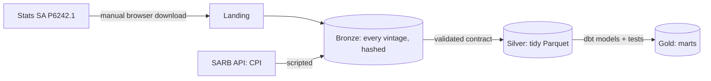

# SA Property Lakehouse

A data platform that answers the questions a South African property owner asks about its tenants
and its market. It covers **tenant trading**, built from national retail sales, and the
**interest rates** that set the cost of property finance.

> **Status: all seven phases complete.** Tenant trading runs on real data through the August 2026
> release. One dbt project builds the marts locally on DuckDB and on AWS on Athena, from silver
> tables that Spark writes as Iceberg. Both give identical results. The AWS account is temporary,
> so the cloud environment may be torn down. SARB interest rates run on both as well.

## What the data shows

Latest 12 months (September 2025 to August 2026) against the 12 before. CPI averaged 3.8%. The full
write-up, including seasonality and interest rates, is in [docs/findings.md](docs/findings.md).

| Retailer type | Segment | Sales growth | Volume | Implied price | Beat CPI? |
| --- | --- | ---: | ---: | ---: | --- |
| Pharmaceuticals and cosmetics | Defensive | 6.5% | 3.5% | 3.0% | Yes |
| All other retailers | Mixed | 5.8% | 7.4% | -1.5% | Yes |
| Food, beverages and tobacco | Defensive | 5.1% | **-1.1%** | 6.3% | Yes |
| Furniture and appliances | Discretionary | 4.7% | 8.9% | -3.8% | Yes |
| General dealers | Defensive | 4.0% | 1.7% | 2.3% | Yes, by 0.2 points |
| Clothing and footwear | Discretionary | 3.4% | 2.9% | 0.5% | No, by 0.4 points |
| Hardware, paint and glass | Discretionary | 2.3% | 0.7% | 1.6% | No |
| **All retailers** | | **4.3%** | **2.6%** | **1.6%** | **Yes, by 0.5 points** |

- **Volume and sales can tell opposite stories.** Furniture and appliances has the strongest volume
  growth, but falling implied prices cut its sales growth to 4.7%. Rent linked to turnover follows
  sales, not volume. Specialist food beat CPI while selling less.
- **Defensive categories are growing on price.** They grew volume 1.5% on sales growth of 4.5%.
  Discretionary categories grew volume 3.2% on sales growth of 3.3%.
- **Hardware is the weakest.** It has the lowest sales growth, with volume down year on year in 12
  of the last 24 months, including each of the last four.
- **Clothing is the most seasonal.** December runs at 1.80 times an average month, against 1.30 for
  general dealers and 1.08 for pharmacy. A clothing tenant's year depends far more on one month.

The latest months are preliminary, and Stats SA revises them. CPI covers services as well as goods,
so "beat CPI" is a benchmark rather than a like-for-like price comparison. Small margins, such as
general dealers and clothing, could flip with revisions.

**Checked against the source.** All 101 growth rates compared with Stats SA's August 2026 release
match at one decimal place: every category for six months at both price bases, plus five annual
totals. The marts built on Athena pass the same check, and match the local marts on all 1,907
rows. Run `make reconcile` or `make cloud-check` to repeat this.

## Questions

Tenant trading:

1. How has retail turnover grown over the last 24 months, by retailer type?
2. How much of that growth is real, and how much is price?
3. Which categories are growing above CPI, and which are shrinking in real terms?
4. Which categories are most seasonal, and how do defensive and discretionary categories compare?

See [docs/business-questions.md](docs/business-questions.md) for how each one is answered.

**What this data can't show.** Stats SA's retail trade sales are national figures by retailer type,
not tenant turnover. Growth here compares the same category in the same month a year apart. It is
not same-store growth, because store openings and closures are included. Use it as a market
benchmark: a landlord can compare its own tenants' like-for-like growth against it.

## How it works



| Step | Locally | On AWS |
| --- | --- | --- |
| Into bronze | Python, from the landing folder | Lambda, on upload or weekly schedule |
| Orchestration | `make` targets, run in order | Step Functions: ingest, Spark, then dbt in CodeBuild. Emails on failure |
| Bronze to silver | Python parser and contract | The same code, in Spark on Glue, writing Iceberg |
| Silver to gold | dbt on DuckDB | The same dbt models on Athena, writing Iceberg |

Both runs use one parser and one set of dbt models, so they can't drift apart.

The main decisions are explained in [docs/design-decisions.md](docs/design-decisions.md), and every
column is described in [docs/data-dictionary.md](docs/data-dictionary.md).

## Run it

Requires Python 3.12 or later, and Java 8, 11 or 17 for the Spark tests. `make install` uses
`/opt/anaconda3/bin/python` by default; override it with `BOOTSTRAP_PYTHON=python3.12`.

```bash
make install
make test
make cpi       # fetch CPI from SARB
make rates     # fetch the policy rate, prime and bond yield from SARB
```

Retail data takes one manual step, because Stats SA's site blocks scripted clients:

1. In a browser, go to [statssa.gov.za](https://www.statssa.gov.za) and download the time series
   data for release P6242.1, Retail trade sales.
2. Put the Excel workbook (`.xlsx`) anywhere under `data/landing/stats_sa/retail_trade/`. Keep only
   the latest one there: other formats are ignored, and two workbooks stop the run.
3. Run `make retail`, then `make gold`, which builds and tests the dbt models.

Marts are written to `data/gold/warehouse.duckdb`. `make dashboard` turns them into one interactive
page, `data/dashboard/index.html`, that opens from disk with no server or network.

## AWS

`make tf-check` validates the Terraform and needs no AWS account. Deploying needs AWS credentials
and a `terraform.tfvars` copied from the example in `infra/envs/dev/`:

```bash
make tf-plan      # review what would be created
make tf-apply     # creates billable resources
make glue-run     # Spark on Glue: bronze to silver, a few cents
make dbt-athena   # dbt on Athena: silver to gold, under a cent
make pipeline-run # the whole pipeline through Step Functions, a few cents
make cloud-check  # compares the Athena marts with local marts and published figures
make tf-destroy   # removes everything, including the data in the bucket
```

The cost design and guardrails are in [docs/aws-costs.md](docs/aws-costs.md).

## Roadmap

| Phase | Scope | Status |
| --- | --- | --- |
| 1 | Local ingestion and DuckDB marts for tenant trading | Done |
| 2 | Terraform: S3, IAM, Glue; ingestion on Lambda | Done, verified on AWS |
| 3 | PySpark on Glue: bronze to silver with Iceberg | Done, verified on AWS |
| 4 | dbt marts on DuckDB and Athena, with data tests | Done for tenant trading |
| 5 | SARB interest rates and their mart | Done, verified on AWS. REIT prices were dropped: no free source allows this use |
| 6 | Orchestration with Step Functions, triggered by schedule and upload | Done, verified on AWS |
| 7 | Dashboard and written findings | Done |

## Data sources

Retail trade sales: Statistics South Africa, release P6242.1. CPI and interest rates: South African
Reserve Bank web API, series `CPI1000F`, `MMRD002A`, `MMRD000A` and `CMJD004A`. Source data is not stored in this repository.

## License

[MIT](LICENSE)
